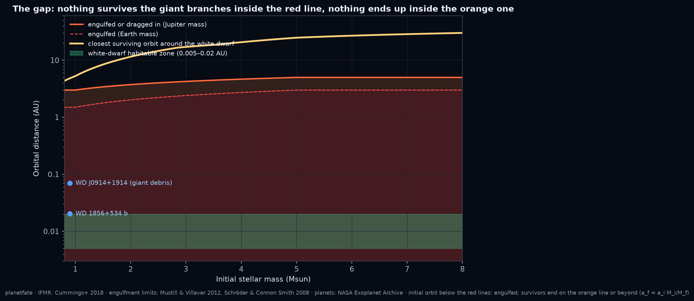
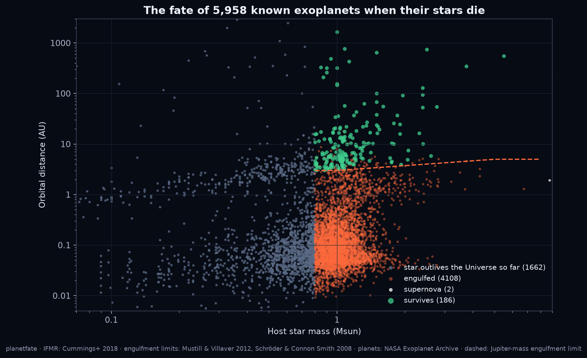
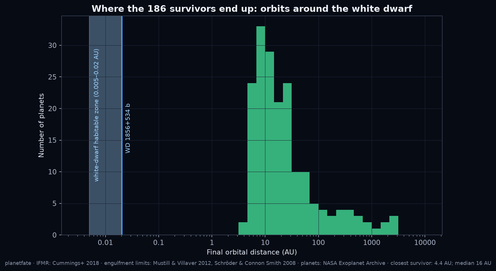
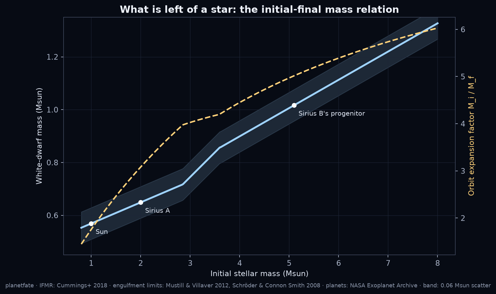

# planetfate

**Which planets survive the death of their star, and where they end up.**

Stars below about 8 solar masses swell into red giants, shed most of their mass and leave a white dwarf.
`planetfate` encodes what the literature says happens to their planets, applies it to any catalogue, and checks
the key step with direct N-body integrations:

1. **Initial-final mass relation** (Cummings et al. 2018): how much star is left.
2. **Engulfment and tidal capture on the giant branches** (Mustill & Villaver 2012; Schröder & Connon Smith 2008):
   a critical initial orbit below which the planet is lost.
3. **Adiabatic orbit expansion** (Debes & Sigurdsson 2002; Veras 2016): survivors move out by M_i/M_f.
4. **Post-mass-loss instability** (Debes & Sigurdsson 2002): multi-planet systems that were stable become unstable
   because the Hill spacing shrinks; REBOUND runs included.

Built for the [Kister Space](https://www.youtube.com/@KisterSpace) search for planets around white dwarfs, as the
companion of [wdclock](https://github.com/ChristianJair27/wdclock).



## Use

```bash
pip install -e .[nbody,plots]
planetfate one --mstar 1.0 --a 5.2 --mp 1.0         # Jupiter: survives, ends at 9.1 AU (period 36 yr)
planetfate one --mstar 1.0 --a 1.0 --mp 0.00315     # Earth: engulfed
planetfate ifmr --mstar 1 2 3 5                     # white-dwarf masses, expansion factors, closest surviving orbit
planetfate catalog exoplanets.csv fates.csv         # any table with st_mass, pl_orbsmax (pl_bmassj, pl_orbeccen optional)
python examples/known_exoplanets.py --download      # the NASA Exoplanet Archive, end to end, with figures
```

```python
from planetfate import fate, final_mass, a_crit
fate(2.0, 10.0, m_planet_mjup=1.0)   # Fate(verdict='survives', m_final=0.649, a_final=30.8 AU, ...)
```

## Results on the NASA Exoplanet Archive (pscomppars, 2026-11-09, 6,464 planets)

| | |
|---|---|
| planets with a host mass and an orbit | 5,958 |
| hosts below 0.8 Msun: the star outlives the Universe so far | 1,662 |
| hosts above 8 Msun: supernova | 2 |
| hosts that end as white dwarfs | 4,294 |
| engulfed or tidally dragged in | 4,108 (95.7 %) |
| survive | 186 (4.3 %) |
| closest survivor around its white dwarf | 4.45 AU |
| median survivor: orbit / period | 16 AU / 88 yr |
| survivors ending inside 1 AU | 0 |
| survival by discovery method | transit 0 % · radial velocity 14 % · microlensing 65 % · direct imaging 98 % |

The closest a surviving Jupiter can end up: 5.3 AU (1 Msun progenitor), 11.5 AU (2 Msun), 17 AU (3 Msun), 25 AU
(5 Msun). Everything we know at 0.01-0.1 AU around white dwarfs, including the transiting giant WD 1856+534 b at
0.02 AU, therefore arrived there after the star died, by scattering or Kozai cycles followed by tidal circularisation.
Nordhaus & Spiegel (2013) reached the same conclusion for the ~300 planets known then ("relatively few" survive; gap
edge at 4-40 AU); this is the 2026 census with the same physics.





## N-body checks (REBOUND 5, IAS15, units AU / yr / Msun)

- `mass_loss_run`: a planet at 1 AU around a 1.5 Msun star losing mass to 0.52 Msun over 20,000 yr ends within 2 % of
  the adiabatic prediction a_i M_i/M_f (test suite).
- `instability_run`: three Jupiter-mass planets at a fixed mutual Hill spacing Δ, first at constant stellar mass,
  then through a 200,000-yr mass loss to the white-dwarf mass, then 2 Myr more. See `examples/` and the figure
  `figures/instability.png`; the scan over Δ is described in LEARNING.md.

## Model limits (read before quoting a number)

- The engulfment limit a_crit(M_i, m_p) interpolates four published anchor values (Earth and Jupiter masses at 1 and
  5 Msun, Mustill & Villaver 2012) log-linearly; the real curves depend on metallicity, the AGB thermal pulses and the
  tidal prescription (the cited papers disagree at the 30 % level). Brown dwarfs and binaries are not handled.
- The IFMR scatter (0.06 Msun) and the Archive's host-mass uncertainties are not propagated.
- "Star still alive" is a 0.8 Msun cut, not an age; "supernova" is an 8 Msun cut.
- Composite parameters mix sources; orbits with only a period are converted by the Archive, not here.

## References

Cummings, Kalirai, Tremblay, Ramirez-Ruiz & Choi 2018, ApJ 866, 21 · Mustill & Villaver 2012, ApJ 761, 121 ·
Schröder & Connon Smith 2008, MNRAS 386, 155 · Debes & Sigurdsson 2002, ApJ 572, 556 · Nordhaus & Spiegel 2013,
MNRAS 432, 500 · Veras 2016, Royal Society Open Science 3, 150571 · Veras, Wyatt, Mustill, Bonsor & Eldridge 2011,
MNRAS 417, 2104 (adiabaticity) · Rein & Liu 2012, A&A 537, A128 (REBOUND) · Rein & Spiegel 2015, MNRAS 446, 1424
(IAS15) · NASA Exoplanet Archive, https://exoplanetarchive.ipac.caltech.edu (DOI 10.26133/NEA13 for pscomppars).

## Video

"Which planets survive the death of their star" (6 min, Kister Space, scheduled for 13 November 2026): https://youtu.be/sBm40pS2PLA — its data animations were made with this package (`skyimages/planetfate_anim.py` in the project).

## Status

v0.1.0, 2026-11-09. Written by Christian Jair with Claude (Anthropic). Companion video: "Which planets survive the
death of their star" (Kister Space). Issues and pull requests welcome.
